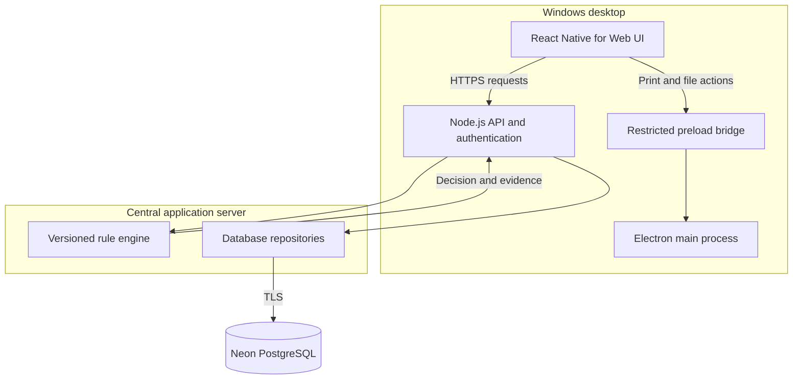

# JU Admission Eligibility Desktop Application

Engineering draft, architecture and decision specification

**Prepared:** 22 October 2026  
**Primary users:** Jahangirnagar University admission-office staff  
**Primary platform:** Windows desktop  
**Requested stack:** Electron + React Native through React Native for Web + Node.js + Neon PostgreSQL  
**Rule source:** Supplied five-page `20_14_01_26_12_15_36document(3).pdf`, JU undergraduate admission circular for **2025-2026**.

> This file is the original engineering blueprint and source extraction. The active checker follows the user-supplied matrix and the [working assumptions](Unresolved_Policy_Questions.md), which override conflicting provisional guidance below. It returns Eligible or Not eligible; missing required data counts as Not eligible until entered, with a short note on the affected requirement. These working assumptions are implementation choices, not university approval.

## 1. What the application will do

The application has two main categories:

1. **Admission Exam Eligibility:** enter O-Level and A-Level results; see which units the candidate meets the requirements to sit for.
2. **Subject / Choice-List Eligibility:** enter the same academic results plus admission-test results for each unit; see which departments meet the published academic and test requirements.

Each decision must explain the candidate's supplied value, the required value, the outcome and the rule's PDF page/section. Staff should be able to understand a failure without reading program code.

**Example:** “IIT: Mathematics section requires at least 13.20/22; candidate scored 13.00/22; requirement not met.”

Passing departmental eligibility is distinct from receiving a seat. Seats, merit position, quotas, document verification and later choice-list notices may impose additional conditions. The first release reports **meets published department requirements**, and uses **eligible to add to the official choice list** only when the session's actual choice-list policy has also been approved and configured.

## 2. Scope and product decisions

| Topic | Draft decision | Reason |
|---|---|---|
| First curriculum | British/GCE O-Level and A-Level | Directly matches the requested forms. |
| Bangladesh curriculum | Preserve a separate policy adapter and source appendix; UI comes later | SSC/HSC GPA conditions must not be applied to O/A candidates without an approved equivalence policy. |
| First input method | Manual entry with certificate verification by staff | Avoids OCR mistakes becoming admission decisions. |
| Certificate upload/OCR | Later optional feature | Extracted subjects and grades must be confirmed before evaluation. |
| First operating mode | Connected, authenticated staff application | Neon is remote and the authority needs consistent rules and an audit history. |
| Offline evaluation | Deferred; no new authoritative decisions while offline | Offline publication/revocation and conflict handling add substantial complexity. |
| Decision engine | Deterministic, versioned TypeScript rules | Same inputs and policy version must reproduce the same decision. |
| AI in eligibility | No AI-based admission decisions | Exact thresholds and traceable logic are needed. |
| Actual admissions processing | Separate future module | This release checks eligibility; it does not submit university applications, collect fees or allocate seats. |
| Interface | Bangla and English labels; keyboard-friendly forms | Staff work involves repeated data entry and Bangla source rules. |

## 3. Technology decisions, including React Native with Electron

Electron's renderer is a browser environment. Use **React Native for Web** to render React Native-style components through React DOM inside the Electron window. This is the compatibility layer that makes the requested combination practical; an Android/iOS React Native runtime is not embedded in Electron.

```text
Electron desktop shell
  React Native components rendered through React Native for Web
  React DOM mounts the UI in Electron's renderer
  Node.js API runs on a separately hosted server
  Neon stores the PostgreSQL data
```

| Layer | Technology | Responsibility |
|---|---|---|
| Desktop container | Electron | Window, installer, printing, file dialogs and application updates. |
| User interface | React + React Native for Web + TypeScript | Forms, results, comparison tables and navigation. |
| Build tooling | Vite renderer build and Electron packaging | Bundle local application assets into a Windows installer. |
| Form state | React Hook Form + shared Zod schemas | Form validation, field errors and repeatable subject rows. |
| Server state | TanStack Query | Requests, loading state and controlled cache invalidation. |
| Backend | Node.js + Fastify + TypeScript | Authentication, authorization, evaluations, rules and history. |
| Decision engine | Shared pure TypeScript package | Evaluate approved predicates and return evidence. |
| Database | Neon PostgreSQL | Candidates, result revisions, policies, evaluations and audit events. |
| Database access | Drizzle ORM + node-postgres (`pg`) | Parameterized SQL, explicit transactions and migrations. |
| Tests | Vitest, backend integration tests and Electron end-to-end tests | Verify policies, boundaries and full staff workflows. |

Implementation details:

- Resolve the **exact** module import `react-native` to `react-native-web` in Vite; do not rewrite unrelated package names. Confirm chosen dependency peer versions together and commit the lockfile.
- Build screens with `View`, `Text`, `TextInput`, `Pressable` and `ScrollView`. Use small web-specific accessible components where necessary for desktop tables, selects and printing.
- Native-only mobile libraries need a web implementation; do not assume every React Native package works in Electron.
- Keep Electron main/preload code separate from the renderer bundle.
- Use supported dependency versions selected during implementation; this draft does not prescribe unverified version numbers.
- Run one centrally hosted Node.js service for all workstations. Electron's bundled Node.js runtime handles desktop integration, not a second copy of the central database service.
- Neon is the **managed PostgreSQL database**, not the desktop framework or application host. The Node.js API requires its own deployment.

## 4. User roles

| Role | Allowed actions |
|---|---|
| Admission operator | Create/edit candidate academic records, run checks, view authorized history and export reports. |
| Policy editor | Draft rules and attach source references; cannot publish their own unreviewed changes. |
| Policy approver | Review evidence, resolve policy questions and publish/revoke rule versions. |
| Administrator | Manage staff accounts, roles, session configuration and operational access. |

A person may hold multiple roles where staffing requires it, but record who drafted and who approved a policy. A policy editor's draft must not change the active evaluator until publication.

## 5. Screen map and workflows

### 5.1 Home

Display the selected admission session and active policy version prominently. Two large actions:

- **Check Admission Exam Eligibility**
- **Check Subject / Choice-List Eligibility**

Additional navigation: candidates, evaluation history, rule management and staff settings according to role.

### 5.2 Admission Exam Eligibility workflow

1. Sign in and select the admission session.
2. Create a candidate record or load an existing candidate.
3. Confirm curriculum, examination board and academic passing years.
4. Enter O-Level subject rows.
5. Enter A-Level subject rows.
6. Review entered grades against certificates; record verification state.
7. Click **Check Units**.
8. See A, B, C, C1, D, E and IBA-JU with separate outcomes and reasons.
9. Save the evaluation and optionally print/export it.

Show every unit, including failed and unresolved units. Do not hide units that need missing information. Department-specific academic previews may appear under a unit to explain why a candidate's route into that unit is restricted.

### 5.3 Subject / Choice-List workflow

1. Load or enter the candidate's O/A results.
2. Select every unit actually attempted.
3. For each attempted unit, enter the admission-test section marks and official total.
4. For C1, enter practical results for each relevant department when available.
5. Reconcile section marks with the total; verify the official result.
6. Click **Check Departments**.
7. Show departments grouped by unit, with all passed, failed and unresolved conditions.
8. Build an advisory preference list from eligible departments.
9. Export the result, including unresolved conditions and the policy version.

The application must not assume one test score applies to every unit. Academic data is shared; each unit examination is a separate record.

### 5.4 Form fields

| Form | Required information | Notes |
|---|---|---|
| Candidate | Internal candidate ID, name, session, curriculum | Phone/other identifiers optional unless operationally necessary. |
| O-Level header | Board, passing year, certificate/verification reference | Handle multiple sittings only according to approved policy. |
| O-Level rows | Canonical subject, printed subject name, syllabus code when available, grade, sitting | Dynamic rows; at least five passed subjects are required by the source. |
| A-Level header | Board, passing year, certificate/verification reference | Distinguish full A-Level from AS. |
| A-Level rows | Same fields as O-Level | At least two passed subjects; some departments need additional A-Level subjects. |
| Unit examination | Unit, attempt/result reference, exam pattern, section scores, official net total | Require all sections for final total reconciliation; allow saving incomplete drafts. |
| C1 practical | Department, score out of 20, status, verification reference | Practical rules are separate from MCQ rules. |

The user describes entering “marks”; for academic eligibility the circular mainly specifies **grades**. Store certified grades as the decision input. Optional raw marks must not be converted into grades using one universal percentage table across boards. Store board-approved equivalence evidence where conversion is required.

### 5.5 Result presentation

Use text labels and icons as well as color:

| Result | Meaning |
|---|---|
| ELIGIBLE | Every implemented required condition passed. |
| NOT_ELIGIBLE | A requirement failed or required information is missing. The affected row shows the value or a short case note. |
| NOT_ATTEMPTED | No test result was entered for that unit. || NOT_ATTEMPTED | Subject-check display state for units with no exam attempt; not an academic failure. |

Each result contains a checklist, such as:

```text
Unit A / IIT
O/A general entry conditions: passed
Academic subject requirements: passed under approved GCE route
Unit A overall MCQ: 45.00 / 80, minimum 36.00 -> passed
Mathematics: 14.00 / 22, minimum 13.20 -> passed
Physics: 12.00 / 22, minimum 13.20 -> failed
Decision: NOT_ELIGIBLE
Reason: Physics section is below 60%.
```

The example assumes the academic rule precedence has already been approved; it does not resolve the ambiguity described below.

## 6. Policy source and extraction register

The supplied PDF is the authority for this draft. The following page references use PDF pages 1-5.

| Reference | PDF location | Content |
|---|---|---|
| SRC-ENTRY | Page 1, section 1(a)-(d) | General years, national GPA table and GCE entry conditions. |
| SRC-GCE | Page 2, section 1(e), English-medium bullets | O/A-Level unit/department subject requirements. |
| SRC-DEPT-A-B | Page 2, department table | A and B academic requirements and MCQ section minimums. |
| SRC-DEPT-C-D-E | Page 3, department table | C, C1, D and E requirements. |
| SRC-IBA | Page 4, first table | IBA academic requirements. |
| SRC-PATTERN | Page 4, section 2 | Unit-wise section maximum marks. |
| SRC-MCQ | Page 4, section 3(a)-(b) | 80-mark MCQ, 0.20 penalty and 36-mark pass threshold. |
| SRC-MERIT | Page 5, section 7 | Merit preparation, GPA weighting and GCE grade points. |
| SRC-CHANGES | Page 5, sections 9-10 | Later quota notice and university's right to amend conditions. |

The source includes application dates, fees, admit cards and hall instructions. They are contextual reference material, not extra eligibility rules. Do not reject an otherwise eligible historical record merely because today's date falls outside the original application window.

## 7. GCE academic rules extracted from the PDF

### 7.1 General entry conditions

For the supplied **2025-2026** session, page 1 section 1(d) states:

- O-Level passing year: **2020 onward**.
- A-Level passing year: **2024 or 2025**.
- At least **five passed O-Level subjects**.
- At least **two passed A-Level subjects**.
- Across the stated **seven subjects**, **four at least B** and **three at least C**.

The checker selects the highest grade per subject, then counts the best five distinct passed O-Level subjects and the best two distinct passed full A-Level subjects. AS results do not count as full A-Level subjects. E counts as passed for subject counts; F and U do not.

The grade-distribution predicate is:

~~~text
count(grade >= B) >= 4
count(grade >= C) >= 3
~~~

A higher grade can satisfy either threshold. The same row is counted once. This is the deterministic working rule for extra subjects and retakes.

### 7.2 GCE unit and department subject requirements

The active checker uses the matrix supplied for this implementation. A-Level applies where the matrix names it; otherwise a subject condition accepts O-Level or full A-Level. GCE A or A* meets an A- or A cutoff; A+ is interpreted as A*.

| Unit / department | Academic requirement | Required test section performance |
|---|---|---|
| A, unit prerequisite | A-Level Physics, Chemistry and Mathematics, each B or higher | Overall MCQ at least 36/80 |
| A / Mathematics | A-Level Mathematics at least A | Mathematics at least 50% |
| A / CSE and IIT | A-Level Mathematics and Physics at least A+ (implemented as A*) | Mathematics and Physics at least 60% each |
| A / Physics | A-Level Physics and Mathematics at least A- | Overall MCQ only |
| A / Chemistry | A-Level Chemistry at least A; Mathematics at least A- | Chemistry at least 60% |
| A / Environmental Sciences | A-Level Chemistry, Physics, Mathematics and Biology at least A- | Overall MCQ only |
| Other A departments | A-unit prerequisite | Overall MCQ only; no extra GCE grade was listed |
| B, unit prerequisite | English at O-Level or full A-Level, at least B | Overall MCQ at least 36/80 |
| B / Economics | English and at least one of Mathematics, Statistics, Economics or Accounting, at least A- | Overall MCQ only |
| B / Geography, Government, Anthropology | Bangla and English, at least A- | Anthropology: Bangla and English sections at least 50% each |
| B / Urban and Regional Planning | Mathematics and English, at least A- | Overall MCQ only |
| B / Public Administration | English at least A- | Overall MCQ only |
| C, unit prerequisite | English at O-Level or full A-Level, at least B | Overall MCQ at least 36/80 |
| C / Bangla | Bangla at least A-; English at least B | Bangla 50%; English 30% |
| C / English | English at both O-Level and full A-Level, at least A | English 60% |
| C / Law, International Relations, History, Philosophy | English at least A- | Law: Bangla and English at least 60% each |
| C / Journalism | General C English prerequisite | English at least 60% |
| Other C departments | General C English prerequisite | Overall MCQ only; no extra cutoff was listed |
| D / Botany, Zoology | A-Level Biology at least A- for Botany and A for Zoology | Corresponding Botany or Zoology section at least 50% |
| D / Pharmacy, Microbiology | A-Level Chemistry and Biology at least A | Chemistry and combined Biology sections at least 50% each |
| D / Biotechnology | A-Level Chemistry and Biology at least A; Physics and Mathematics at least A- | Chemistry and combined Biology sections at least 50% each |
| D / Biochemistry | A-Level Chemistry and Biology at least A (working assumption) | Chemistry and combined Biology sections at least 50% each |
| D / Public Health | Chemistry, Biology, Mathematics and English at least B; O/A accepted for each (working assumption) | Overall MCQ only |
| C1 | Common GCE baseline; no department-specific GCE grades were supplied | Overall MCQ; existing draft practical minimum is 8/20 |
| E and IBA-JU / Science | Common GCE baseline, plus Mathematics and English at least A- | Overall MCQ at least 36/80 |
| E and IBA-JU / Humanities or Business | Common GCE baseline, plus English and at least one of Accounting, Economics or Mathematics at least A | Overall MCQ at least 36/80 |
| Other departments | Apply the unit prerequisite and common GCE baseline | Overall MCQ at least 36/80; no extra section cutoff was supplied |

### 7.3 Working interpretation

- GCE conditions replace national curriculum GPA/grade-table conditions for this checker. A unit prerequisite and its department-specific condition both apply.
- A unit is eligible when the common GCE baseline and its unit prerequisite pass. For D, at least one listed department subject route opens the unit. C1 has no additional GCE subject prerequisite in the supplied matrix.
- The officer selects Science, Humanities or Business for E/IBA. E uses the Business exam pattern for Business and the other E pattern for Science or Humanities.
- MCQ checks use the official net total and net section scores. The 0.20 wrong-answer deduction is assumed to be included already. Listed section percentages apply to those net scores.
- Missing required grades, years, track or test scores produce Not eligible until entered. Certificate and score verification are recorded but do not change the eligibility result.
- Unlisted department conditions are not invented: the unit prerequisite and overall MCQ pass apply, and the affected result includes a short case note.

The [working assumptions register](Unresolved_Policy_Questions.md) records these choices and the eligibility features that this checker does not calculate.

## 8. Admission-test input and exact score rules

### 8.1 Section maximum marks

All patterns below total **80**, from page 4 section 2.

| Unit / pattern | Sections and maxima |
|---|---|
| A | Bangla 3; English 3; Mathematics 22; Physics 22; Chemistry 22; ICT 8. |
| B | Bangla 20; English 20; General Mathematics 20; General Knowledge 15; Logical Analysis 5. |
| C | Bangla 20; English 20; General Knowledge and Department-Related Topics 40. |
| C1 | Bangla 10; English 10; General Knowledge 20; Department-Related Topics 40. |
| D | Bangla 4; English 4; Intelligence 4; Chemistry 24; Botany 22; Zoology 22. Biology is the derived Botany + Zoology total of 44. |
| E, business studies | Bangla 20; English 20; Accounting 20; Management 20. |
| E, science/humanities/equivalent | Bangla 20; English 20; Mathematics and Analytical Ability 20; Business-Related General Knowledge 20. |
| IBA-JU | Bangla 5; English 30; Mathematical Aptitude and IQ 30; Contemporary and Analytical Topics 15. |

The study-track field selects E_BUSINESS for Business and E_OTHER for Science or Humanities.

### 8.2 Overall pass and negative marking

- Overall MCQ pass in every unit: **at least 36/80**, equivalent to 45%.
- Wrong answer penalty: **0.20** per wrong answer.
- Prefer official **net** section scores and net total; do not subtract penalties again.
- Optional correct/wrong/unanswered entry may compute net marks only after the one-mark-per-question and section question-count assumptions are approved.
- Negative net section scores may be possible. For a confirmed one-mark-question pattern with no score floor, validate the lower bound against `-0.20 × section question count`, not zero. Store any university score-floor rule explicitly.
- Store scores as exact decimals, for example PostgreSQL `NUMERIC(7,2)`. Reject excess precision rather than silently rounding inputs.
- Compare before display rounding: `earned × 100 >= required_percent × maximum` using decimal arithmetic or fixed-point integers.
- Enter D Botany and Zoology separately; derive Biology = Botany + Zoology. Do not count Biology twice in the overall total.
- A total of 50/80 does not prove that Mathematics or English section minimums passed. Missing necessary sections result in NOT_ELIGIBLE until entered.

### 8.3 Department minimums from pages 2-4

Every department below also needs the applicable academic rules, an eligible unit route and the overall **36/80** pass. A dash in the source means **no additional section minimum stated in that row**; it does not establish every other admission condition.

| Unit | Department / institute | Additional MCQ minimum |
|---|---|---|
| A | Mathematics | Mathematics >= 50% = 11/22. |
| A | Statistics and Data Science | None stated. |
| A | Chemistry | Chemistry >= 60% = 13.20/22. |
| A | Physics | None stated. |
| A | Geological Sciences | None stated. |
| A | Computer Science and Engineering | Mathematics >= 60% = 13.20/22 AND Physics >= 60% = 13.20/22. |
| A | Environmental Sciences | None stated. |
| A | Institute of Information Technology | Mathematics >= 60% = 13.20/22 AND Physics >= 60% = 13.20/22. |
| B | Economics | None stated. |
| B | Geography and Environment | None stated. |
| B | Government and Politics | None stated. |
| B | Anthropology | Bangla >= 50% = 10/20 AND English >= 50% = 10/20. |
| B | Urban and Regional Planning | None stated. |
| B | Public Administration | None stated. |
| C | Bangla | Bangla >= 50% = 10/20 AND English >= 30% = 6/20. |
| C | English | English >= 60% = 12/20. |
| C | History | None stated. |
| C | Philosophy | None stated. |
| C | Archaeology | None stated. |
| C | International Relations | None stated. |
| C | Journalism and Media Studies | English >= 60% = 12/20. |
| C | Law and Justice | Bangla >= 60% = 12/20 AND English >= 60% = 12/20. |
| C | Comparative Literature and Culture | Bangla >= 40% = 8/20 AND English >= 40% = 8/20. |
| C1 | Drama and Dramatics | Separate MCQ pass; practical >= 40% = 8/20 and separate practical pass. |
| C1 | Fine Arts | Separate MCQ pass; practical >= 40% = 8/20 and separate practical pass. |
| D | Botany | Botany >= 50% = 11/22. |
| D | Zoology | Zoology >= 50% = 11/22. |
| D | Pharmacy | Chemistry >= 50% = 12/24 AND Biology >= 50% = 22/44. |
| D | Biochemistry and Molecular Biology | Chemistry >= 50% = 12/24 AND Biology >= 50% = 22/44. |
| D | Microbiology | Biology >= 50% = 22/44. |
| D | Biotechnology and Genetic Engineering | Chemistry >= 50% = 12/24 AND Biology >= 50% = 22/44. |
| D | Public Health and Informatics | None stated. |
| E | Finance and Banking | None stated. |
| E | Marketing | None stated. |
| E | Accounting and Information Systems | None stated. |
| E | Management Studies | None stated. |
| IBA | Institute of Business Administration, IBA-JU | None stated. |

**37 department/institute options across seven units** are represented. C1 practical records are department-specific. A pending required practical result is NOT_ELIGIBLE until entered.

## 9. Grade systems and merit calculations

Use separate concepts:

1. **Grade ordering:** whether a board's grade meets a minimum such as B.
2. **Grade equivalence:** whether a particular O/A result satisfies an HSC/equivalent academic condition.
3. **Grade-to-point conversion:** numerical points used for GPA/merit calculations.

They are not interchangeable. The page 5 section 7(c) mapping is:

| GCE grade explicitly listed | Points |
|---|---:|
| A | 5.0 |
| B | 4.0 |
| C | 3.5 |
| D | 3.0 |

The circular refers other grades/points to IIT's equivalence committee. It does not explicitly list A*, E, numeric grades, board-specific percentage equivalence, a best-subject aggregation procedure or AS-Level treatment. Store these as approval questions. An approved board ordering can allow A* to satisfy a B minimum while its merit-point conversion remains unresolved; do not block a known grade comparison merely because a separate merit conversion is unknown.

The source's merit formula is:

```text
merit total = admission MCQ score + (SSC/equivalent GPA × 1.5)
                                  + (HSC/equivalent GPA × 2.5)
```

For GCE, do not invent the method of converting selected grade points into the two GPA values. Require an approved aggregation policy or verified equivalence values. Final rank, tie-breaks and C1 practical weighting need additional policy; they are not necessary for the first eligibility checker. The circular states up to ten times the seats may be merit-listed and C1 final merit follows practical examination; neither statement guarantees a seat or defines a universal choice-list gate.

## 10. Decision engine design

### 10.1 Rule representation

Rules are structured data, not editable JavaScript or SQL. Support a small validated set of operations:

| Operation | Example |
|---|---|
| `all` | Physics B AND Chemistry B AND Mathematics B. |
| `any` | English B in O-Level OR A-Level. |
| `atLeast` | At least four selected subjects at B or better. |
| `gradeAtLeast` | A-Level Biology >= B under a specified board grade scale. |
| `yearIn` / `yearAtLeast` | A-Level in {2024, 2025}; O-Level >= 2020. |
| `scoreAtLeast` | Overall MCQ >= 36/80. |
| `percentAtLeast` | Physics >= 60% of its configured maximum. |
| `approvedEquivalence` | Reference a verified equivalence decision. |

Every rule has `id`, session, curriculum, phase, target unit/department, source page/section, approval state and a human-readable explanation template. Source evidence and the approved interpretation should both be retained.

Illustrative IIT MCQ expression:

```json
{
  "id": "JU-2025-26-A-IIT-MCQ",
  "phase": "POST_EXAM",
  "unitCode": "A",
  "departmentCode": "IIT",
  "source": { "pdfPage": 2, "section": "A department table, IIT row" },
  "expression": {
    "op": "all",
    "children": [
      { "op": "scoreAtLeast", "field": "exam.netTotal", "value": "36.00" },
      { "op": "percentAtLeast", "section": "MATHEMATICS", "value": "60" },
      { "op": "percentAtLeast", "section": "PHYSICS", "value": "60" }
    ]
  }
}
```

This expression covers the MCQ component only. Passing it must not bypass academic checks.

### 10.2 Definite displayed results

The active engine displays Eligible or Not eligible. Every required condition must pass for Eligible. Missing required values are shown on the affected check and produce Not eligible until the record is completed. A unit with no exam attempt remains Not attempted in the department screen. Certificate and score verification are recorded separately from eligibility.

### 10.3 Evaluation algorithm

```typescript
// Illustrative design pseudocode; supporting functions are separate modules.
async function checkEligibility(request, authenticatedStaff) {
  authorize(authenticatedStaff, "evaluation:create");
  const input = validateAndNormalize(request);
  const policy = await loadPublishedPolicy(input.sessionId, input.policyVersion);

  return database.transaction(async (tx) => {
    const snapshot = await loadImmutableInputRevision(tx, input.revisionId);
    const context = bindBoardScalesAndExamPatterns(snapshot, policy);
    const targets = selectTargets(input.phase, policy);
    const outcomes = targets.map(target =>
      evaluateTargetWithEvidence(target, context, policy)
    );
    return persistEvaluationAndAudit(tx, {
      requestId: input.requestId,
      inputSnapshot: snapshot,
      policyVersion: policy.version,
      policyHash: policy.hash,
      engineVersion: ENGINE_VERSION,
      outcomes,
      actorId: authenticatedStaff.id
    });
  });
}
```

Post-exam checks must re-evaluate the academic gates under the chosen policy snapshot, then apply overall MCQ, section and practical conditions. Do not trust a previously stored green unit badge after grades or rules change.

### 10.4 Reproducibility and policy publication

- Policies progress through `DRAFT -> REVIEWED -> PUBLISHED -> RETIRED` or `REVOKED`.
- The current GCE checker applies documented working assumptions and shows short notes beside affected checks. Missing required values produce NOT_ELIGIBLE until entered; this implementation does not assert university approval.
- Store immutable published snapshots with SHA-256 content hashes and engine-schema versions.
- Publication atomically moves a session's active-policy pointer. In-flight evaluations retain the snapshot they started with.
- Published rules cannot be edited in place; amendments create a new version.
- Save candidate input revision, evidence, policy version and engine version for every evaluation.
- Editing marks invalidates the current displayed result until recalculation. Historical results remain tied to their old revisions.
- Re-evaluation creates a new result and can show differences; it never rewrites history.
- Manual adjudication is a separate signed record with a reason, scope and reviewer. It does not silently change the original engine result or create a new universal rule.

## 11. Architecture



### 11.1 Responsibility boundaries

**Renderer:** displays forms and results, performs immediate non-authoritative validation, calls the API with candidate revision IDs. It never receives database credentials or computes a trusted final decision on its own.

**Preload:** exposes a small typed interface such as `printReport(evaluationId)` and a controlled file picker. No raw `ipcRenderer`, arbitrary file access, command execution or SQL methods.

**Electron main:** manages windows and OS features, validates IPC sender and payload, restricts navigation, and handles protected local tokens. Printing must use an authorized evaluation or validated report payload; never load an arbitrary renderer-supplied URL into a privileged window.

**Node.js API:** authenticates staff, verifies permissions, loads approved policies, validates all input again, runs evaluations and writes audit records. The API is the authoritative decision boundary.

**Neon:** holds structured application data. Use a bounded `pg` pool against Neon's pooled connection URL for normal traffic; use a migration-specific connection where migration tooling requires it. Keep credentials in server secrets and require TLS.

### 11.2 Network failure behavior

Display a clear connection state and retain the current unsent form in memory. Retry reads carefully; use request IDs for writes so retries do not create duplicate evaluations. If a save's response is lost, query by request ID before resubmitting. Do not show an offline calculation as an authoritative fresh result. A future encrypted offline mode requires its own policy freshness, access, sync and conflict design.

## 12. Database design

Use UUID primary keys, UTC timestamps and explicit foreign keys. Render operational times in Asia/Dhaka. Use session codes such as `2025-2026`, not the workstation's current year.

| Table | Important fields | Purpose |
|---|---|---|
| `staff_users` | id, identity subject, display name, status | Staff identities. |
| `roles`, `staff_roles` | staff_id, role_id | Role assignments. |
| `admission_sessions` | id, code, active_policy_version_id, state | Session and active policy pointer. |
| `candidates` | id, internal reference, name, created_by | Minimal candidate identity. |
| `candidate_sessions` | candidate_id, session_id, curriculum, verified stream | Links a candidate to a session. |
| `academic_revisions` | id, candidate_session_id, revision_no, completeness, verified_by, verified_at | Immutable academic snapshots after submission. |
| `academic_exams` | id, revision_id, level, board, year, sitting | O-Level / A-Level headers. |
| `academic_results` | exam_id, canonical_subject_id, syllabus_code, raw_name, grade, optional raw_mark | One subject result per sitting. |
| `subjects`, `subject_aliases` | canonical code, board, syllabus, alias, approval | Normalize Mathematics/Maths without guessing equivalence. |
| `unit_exam_revisions` | id, candidate_session_id, unit_id, pattern_id, total, verification | Versioned official admission results. |
| `exam_section_scores` | exam_revision_id, section_id, net_score | Unit-specific net marks. |
| `practical_results` | revision, department_id, score, status, verification | C1 practical evidence. |
| `units`, `departments` | code, names_bn/en, unit_id, session availability | Seven units and their department options. |
| `exam_patterns`, `exam_sections` | session, unit, group, maxima, optional score floor | Versioned test structures. |
| `policy_versions` | session, version, state, content_hash, engine_schema, approvals | Immutable rule bundle metadata. |
| `rules` | policy_version_id, target, phase, curriculum, expression_jsonb, source_id | Validated policy expressions. |
| `policy_sources` | filename, document_hash, PDF page, section, excerpt, interpretation | Trace each rule to its evidence. |
| `equivalence_decisions` | candidate/result scope, approved mapping, reviewer, reason | Board/grade/subject equivalence evidence. |
| `evaluations` | request_id, candidate_session, input_snapshot_jsonb, policy_version, engine_version, actor, created_at | Reproducible calculation record. |
| `evaluation_items` | evaluation_id, target, outcome, checks_jsonb | Target decisions and detailed reasons. |
| `choice_list_drafts`, `choice_list_items` | candidate_session, evaluation_id, department, priority | Advisory preference list tied to an evaluation. |
| `adjudications` | evaluation_item_id, reviewer, outcome, reason, approval_reference | Human decisions without erasing calculations. |
| `audit_events` | actor, action, entity, revision, request_id, timestamp | Access and change accountability. |

Important constraints:

- Unique `(candidate_id, session_id)` for candidate-session records.
- Unique `(session_id, policy_version)` and a single active policy pointer per session.
- Unique `(staff_id, request_id)` for idempotent evaluation submissions.
- Unique section score per exam revision and section.
- Unique department and unique preference priority within a choice-list draft.
- Validate section membership and maxima against the referenced immutable pattern.
- Check overall total equals the sum of non-overlapping sections using exact decimals.
- Do not make canonical subject globally unique across O/A levels: the same subject legitimately appears in both. Retakes must stay identifiable.
- Apply optimistic concurrency (`revision` / `If-Match`) on editable drafts; do not overwrite another operator's changes.
- Keep candidate records separate from immutable calculation snapshots so later edits do not alter historic decisions.

## 13. Backend API draft

Base path: `/api/v1`. All routes require appropriate staff authorization except health and authentication entry points.

| Method and path | Purpose |
|---|---|
| `GET /sessions` | List supported sessions and active policy metadata. |
| `GET /sessions/:id/catalog` | Units, departments, subjects, grade scales and exam patterns. |
| `POST /candidates` | Create candidate identity. |
| `GET /candidates/:id` | Load an authorized candidate. |
| `POST /candidates/:id/sessions` | Attach a session/curriculum. |
| `POST /candidate-sessions/:id/academic-revisions` | Save academic input revision. |
| `POST /candidate-sessions/:id/exam-revisions` | Save unit examination revision. |
| `POST /candidate-sessions/:id/practical-revisions` | Save practical evidence. |
| `POST /evaluations/units` | Evaluate admission-exam unit eligibility. |
| `POST /evaluations/departments` | Evaluate post-exam department eligibility. |
| `GET /evaluations/:id` | Fetch a saved immutable result. |
| `GET /candidate-sessions/:id/evaluations` | Evaluation history. |
| `POST /choice-list-drafts` | Save an advisory preference list. |
| `POST /policy-versions` | Create a draft policy. |
| `POST /policy-versions/:id/review` | Record policy review. |
| `POST /policy-versions/:id/publish` | Publish after role and completeness checks. |
| `POST /evaluations/:id/adjudications` | Record authorized manual review. |

Example department-check request:

```json
{
  "requestId": "client-generated-unique-request-id",
  "candidateSessionId": "candidate-session-uuid",
  "academicRevisionId": "academic-revision-uuid",
  "examRevisionIds": ["unit-a-exam-revision-uuid"],
  "policyVersionId": "published-policy-version-uuid",
  "phase": "POST_EXAM"
}
```

Example item in a result:

```json
{
  "unitCode": "A",
  "departmentCode": "IIT",
  "status": "NOT_ELIGIBLE",
  "checks": [
    {
      "ruleId": "A-IIT-PHYSICS-60",
      "result": "FAIL",
      "actual": "13.00",
      "required": "13.20",
      "maximum": "22.00",
      "source": { "pdfPage": 2, "section": "IIT row" }
    }
  ]
}
```

The example shows one failed check; production responses include all relevant checks, verification state, policy version, engine version and evaluation ID. Reject invalid payloads with field-level errors. Missing candidate information or an uncertain rule is a domain outcome; database/server failures must be reported as operational errors, never as NOT_ELIGIBLE.

## 14. Security and operations

- Package local UI assets; prevent arbitrary remote navigation and new windows.
- Electron renderer preferences: `nodeIntegration: false`, `contextIsolation: true`, `sandbox: true`.
- Restrict IPC to named methods with validated inputs and a trusted sender. Use a restrictive Content Security Policy permitting only required assets and the API origin.
- Use staff identity through the university's identity provider when available, or a separately configured backend-managed authentication system. Prefer system-browser sign-in with PKCE for desktop OAuth; no embedded client secret.
- Keep short-lived access tokens in memory and protect any persistent refresh token through OS-backed storage. Enforce server-side role checks regardless of hidden UI buttons.
- Keep `DATABASE_URL` and signing secrets only on the API server. Do not place them in Electron, renderer environment variables or the installer.
- Log IDs and operational metadata; avoid dumping transcripts or tokens to logs.
- Encrypt backups and define retention with the university. Restrict candidate exports and record access to sensitive records.
- Use database constraints and parameterized queries; never interpret rule data as executable code.
- Test Neon backup/restore and application recovery before launch; do not assume a hosting plan's retention features without verification.
- Sign Windows installers and update packages. Distribute through a controlled channel with rollback to a compatible application version.
- Keep desktop, API and rule schema compatibility explicit; an unsupported engine/policy combination must fail visibly.

Server environment outline, using placeholders only:

```dotenv
NODE_ENV=production
DATABASE_URL=<server-only-neon-pooled-connection>
MIGRATION_DATABASE_URL=<server-only-migration-connection>
AUTH_ISSUER=<approved-staff-identity-provider>
AUTH_AUDIENCE=<application-api-audience>
LOG_LEVEL=info
```

Public desktop configuration includes only the API origin and application metadata. Provision actual credentials outside source control.

## 15. Repository and module layout

```text
ju-admission-checker/
  apps/
    desktop/
      electron/
        main.ts
        preload.ts
        ipc/
      src/
        screens/
        components/
        forms/
        api/
        localization/
    api/
      src/
        modules/auth/
        modules/candidates/
        modules/evaluations/
        modules/policies/
        modules/choice-lists/
        repositories/
  packages/
    eligibility-engine/
      predicates/
      evaluation/
      evidence/
    contracts/
    database/
      schema/
      migrations/
    policy-fixtures/
      ju-2025-2026/
  tests/
    policy/
    integration/
    desktop/
  docs/
    source-register.md
    policy-decisions.md
    deployment.md
```

The engine must not import React, Electron or database clients. API contracts contain shared input/output validation, while repositories handle persistence. Fixtures carry example approved and unresolved policies separately; unresolved draft policy must never be silently promoted during a build.

## 16. Validation and acceptance tests

Policy correctness is the highest-risk part of this application. Boundary tests and authority-reviewed cases are necessary even when the form UI is simple.

| Case | Expected outcome |
|---|---|
| Seven selected qualifying subjects, four B and three C | Grade distribution passes, provided selection and board policies are approved. |
| Seven B grades | Pass distribution; no requirement for exactly three literal C grades. |
| Three B and four C | Fail four-at-least-B condition. |
| Only four passed O-Level subjects, complete record | Fail minimum O-Level count. |
| Only one passed A-Level subject, complete record | Fail minimum A-Level count. |
| O-Level in 2019 | Fail the supplied session's O-Level year condition. |
| A-Level in 2023 | Fail the supplied session's A-Level year condition. |
| Extra subjects or retakes | Select the highest grade per subject, then the best five O-Level and best two full A-Level results. |
| A* with no merit aggregation | Treat A* as above A for eligibility; merit calculation stays out of scope. |
| AS grade entered as full A-Level | Validation/review prevents it being silently counted as full A-Level. |
| English B at O-Level, C at A-Level, approved B-unit route | Explicit O OR A English condition passes. |
| Statistics route passes but general A subject gate fails | Apply the A-unit Physics, Chemistry and Mathematics B prerequisite. |
| Overall net MCQ 35.80 and 36.00 | First fails; second passes overall requirement. |
| IIT Mathematics 13.00 and 13.20 out of 22 | First fails 60%; second passes exactly. |
| C Law: Bangla 12/20, English 11.80/20 | Fail English section even if overall score is high. |
| D Botany 12, Zoology 10 | Biology derives to 22/44; Botany passes 11/22; Zoology fails its own 11/22 condition. |
| C1 MCQ passes, required practical pending | NOT_ELIGIBLE until the practical result is entered. |
| C1 practical 7.80 and 8.00 out of 20 | First fails; second passes practical minimum. |
| Official total differs from section sum | Reject final evaluation until reconciled; preserve draft entry. |
| Total available, required section missing | NOT_ELIGIBLE until the section score is entered. |
| Required failure and another missing value | NOT_ELIGIBLE with both reasons retained. |
| Candidate entered no test attempt for B | NOT_ATTEMPTED display in post-exam section. |
| Rules or grades change after evaluation | Old result remains immutable; new evaluation uses explicit new revision. |
| Operator tries to publish policy | Authorization denied. |
| Duplicate submission after network timeout | Same idempotent evaluation returned, no duplicate history. |

Release acceptance:

1. Every displayed unit and all 37 department/institute options map to the source register.
2. Authority reviewers validate the academic precedence and every GCE equivalence used by automated decisions.
3. The two home-page workflows complete on a clean Windows installation.
4. Each department result includes exact section thresholds, academic checks and source references.
5. No total score substitutes for missing section data.
6. Reports reproduce saved inputs, policy hash/version, verification status and outcomes.
7. No database secret is present in the packaged desktop application.
8. Backup restore, authentication failure, API outage and policy-version incompatibility are exercised.

## 17. Implementation sequence

### Milestone 1: Rulebook and policy decisions

- Register the supplied PDF and its hash.
- Transcribe and independently review rules by page.
- Resolve the authority questions in section 19.
- Build canonical subjects, board grade scales and session-specific exam patterns.
- Produce a reviewed golden dataset of candidate cases.

**Exit:** a published policy can explain each enabled automated outcome; unresolved targets are explicitly marked.

### Milestone 2: Desktop and service foundation

- Create the TypeScript workspace and React Native for Web renderer.
- Add Electron main/preload boundaries and Windows packaging.
- Deploy the Node.js API, Neon schema and migrations.
- Implement staff authentication, roles and session/catalog loading.

**Exit:** a staff member can sign in from the packaged desktop app and load the correct session.

### Milestone 3: Admission-exam eligibility

- Implement O/A subject forms, normalization and complete/incomplete transcript states.
- Save candidate academic revisions.
- Implement grade/year/count rules and unit pathways.
- Display explained unit decisions and evaluation history.

**Exit:** all seven unit outcomes match the reviewed golden cases.

### Milestone 4: Subject eligibility

- Add per-unit section scores, D Biology derivation and C1 practical input.
- Add all department rules and detailed evidence.
- Build advisory preference lists and printable reports.

**Exit:** all 37 department options are covered; exact boundaries and missing-data behavior pass tests.

### Milestone 5: Pilot and operational release

- Run supervised cases with admission staff and compare against manual decisions.
- Finalize policy publishing, amendment history and adjudications.
- Verify Windows installer/update, export permissions, backup restore and monitoring.
- Obtain authority acceptance of enabled automated rules.

**Exit:** staff can complete both workflows with approved rules and recoverable audit history.

Optional later work: Bangladesh national curriculum UI, reviewed OCR import, batch CSV workflows, encrypted offline drafts, official result import and seat-allocation integration. Do not add these to the first release merely because the data model can accommodate them.

## 18. National-curriculum reference appendix

These conditions are retained to reflect the full PDF context. They describe the national/equivalent tables and **must not automatically become GCE rules**.

### 18.1 General session rules and unit GPA thresholds

National SSC/equivalent year is **2022 onward**; HSC/equivalent is **2024 or 2025**. GPA includes the fourth subject. The GCE year rule is different and is listed separately above.

| Unit | Combined GPA minimum | Individual minima / group |
|---|---:|---|
| A | 8.50 | Each >= 4.00. |
| B and C, science | 8.50 | Each >= 3.50. |
| B and C, humanities/business/other | 7.50 | Each >= 3.50. |
| C1 | 7.50 | Each >= 3.50. |
| D | 9.00 | Each >= 4.00. |
| E | 8.00 | SSC >= 4.00; HSC >= 3.50. |
| IBA, science | 8.00 | Each >= 3.75. |
| IBA, humanities/business/other | 7.50 | Each >= 3.50. |

### 18.2 Department academic conditions in the HSC/equivalent tables

Here `AND` requires all subjects and slash alternatives mean at least one listed subject, subject to approved interpretation. Grades are the source's national-table symbols; they are not interchangeable with the GCE grade scale. Shared MCQ conditions are in section 8.

| Unit | Department | Source academic minimum |
|---|---|---|
| A | Mathematics | Mathematics A. |
| A | Statistics and Data Science | Mathematics OR Statistics A. |
| A | Chemistry | Chemistry A AND Mathematics A-. |
| A | Physics | Physics A- AND Mathematics A-. |
| A | Geological Sciences | Physics A AND Chemistry A AND Mathematics A. |
| A | CSE | Mathematics A+ AND Physics A+. |
| A | Environmental Sciences | Chemistry, Physics, Mathematics and Biology, each A-. |
| A | IIT | Mathematics A AND Physics A. |
| B | Economics | English A- AND one of Mathematics / Statistics / Economics / Accounting A-. |
| B | Geography and Environment | Bangla A- AND English A-. |
| B | Government and Politics | Bangla A- AND English A-. |
| B | Anthropology | Bangla A- AND English A-. |
| B | Urban and Regional Planning | Mathematics A- AND English A-. |
| B | Public Administration | English A-. |
| C | Bangla | Bangla A- AND English B. |
| C | English | English A in both secondary and higher-secondary examinations. |
| C | History | English A-. |
| C | Philosophy | English A-. |
| C | Archaeology | English A-. |
| C | International Relations | English A-. |
| C | Journalism and Media Studies | English A-. |
| C | Law and Justice | English A-. |
| C | Comparative Literature and Culture | English A-. |
| C1 | Drama and Dramatics | Bangla B AND one other subject B. |
| C1 | Fine Arts | Bangla B AND English B. |
| D | Botany | Biology A-. |
| D | Zoology | Biology A. |
| D | Pharmacy | Chemistry A AND Biology A AND Physics A- AND Mathematics A-. |
| D | Biochemistry and Molecular Biology | Chemistry A AND Biology A. |
| D | Microbiology | Chemistry A AND Biology A. |
| D | Biotechnology and Genetic Engineering | Chemistry, Physics, Biology and Mathematics, each A. |
| D | Public Health and Informatics | Chemistry A AND Biology A AND English A- AND Mathematics A-. |
| E | Finance and Banking | Business/humanities/other: English A- AND one of Mathematics / Economics / Accounting / Business Principles and Applications A-. Science: Mathematics A- AND English A-. |
| E | Marketing | Same group-specific E condition. |
| E | Accounting and Information Systems | Same group-specific E condition. |
| E | Management Studies | Same group-specific E condition. |
| IBA | IBA-JU | Science: English A- AND Higher Mathematics OR Statistics A-. Humanities/business/other: English A- AND one of Accounting / Economics / Mathematics / Business Organization and Management / Finance, Banking and Insurance A-. |

For IBA science, group the expression as `English >= A- AND (Higher Mathematics >= A- OR Statistics >= A-)`; English is not optional.

## 19. Authority decisions required before exact automated use

| ID | Question | Affected behavior |
|---|---|---|
| P01 | Are GCE entry rules independent of the national GPA minima, or do approved equivalent GPA minima also apply? | Common unit gates. |
| P02 | How are the qualifying seven chosen with extra subjects, retakes or multiple sittings? | General GCE grade distribution. |
| P03 | Do A-unit Statistics and other special clauses replace the general subject combination? | A-unit pathways and department gates. |
| P04 | Is a unit open when at least one department academic route is satisfied, especially D? | Exact pre-exam unit decision. |
| P05 | Do GCE academic bullets replace or supplement national-table academic conditions? | All GCE department checks. |
| P06 | What are the level bindings of Statistics, B Economics, B Planning and C Bangla special requirements? | O-Level versus A-Level subject matching. |
| P07 | Does the D Public Health O/A parenthesis apply to English only or all listed subjects? | D Public Health academic eligibility. |
| P08 | What GCE academic equivalents apply to C1, E and IBA where no special bullet appears? | Automated decisions for those targets. |
| P09 | Which grade orderings, A*/numeric conversions, subject aliases and AS qualifications are approved by board? | Exact grade comparisons and qualification counts. |
| P10 | How do GCE points aggregate into SSC-equivalent and HSC-equivalent GPA? | Merit computation and any approved GPA gates. |
| P11 | Which E test pattern applies to each GCE candidate? | Correct score form and reconciliation. |
| P12 | Are section minimums based on official net scores, and is any negative-score floor applied? | Exact section comparisons and input validation. |
| P13 | What later notices govern choice-list access, quotas, tie-breaks, document verification and C1 merit weighting? | Official choice-list authorization and later admissions processing. |

The software can be developed with explicit review outcomes while these are resolved. It cannot truthfully promise a fully exact automated answer for an affected case until the applicable policy is settled.

## 20. Technical references

Official documentation checked on 22 October 2026 for compatibility and architecture. These sources support technical design; admission policy comes from the supplied PDF.

- [React Native for Web introduction](https://necolas.github.io/react-native-web/docs/): compatibility layer that renders React Native-compatible code using React DOM.
- [React Native for Web setup](https://necolas.github.io/react-native-web/docs/setup/): exact module aliasing and bundler integration.
- [Electron security guidance](https://electronjs.org/docs/latest/tutorial/security): process isolation, safe renderer settings and restricted desktop capabilities.
- [Electron context isolation](https://electronjs.org/docs/latest/tutorial/context-isolation): separating renderer access from preload privileges.
- [Neon connection pooling](https://neon.com/docs/connect/connection-pooling): pooled database connections for application services.

## 21. Definition of a completed first release

An authorized staff member can install the Windows application, select an approved session, enter and verify a candidate's O-Level and A-Level results, obtain explained unit eligibility, enter each attempted unit's section/practical results, obtain explained department eligibility, and print a reproducible report. Every decision uses an identified policy version. Any decisive unresolved condition produces a visible review outcome instead of a guessed answer.

